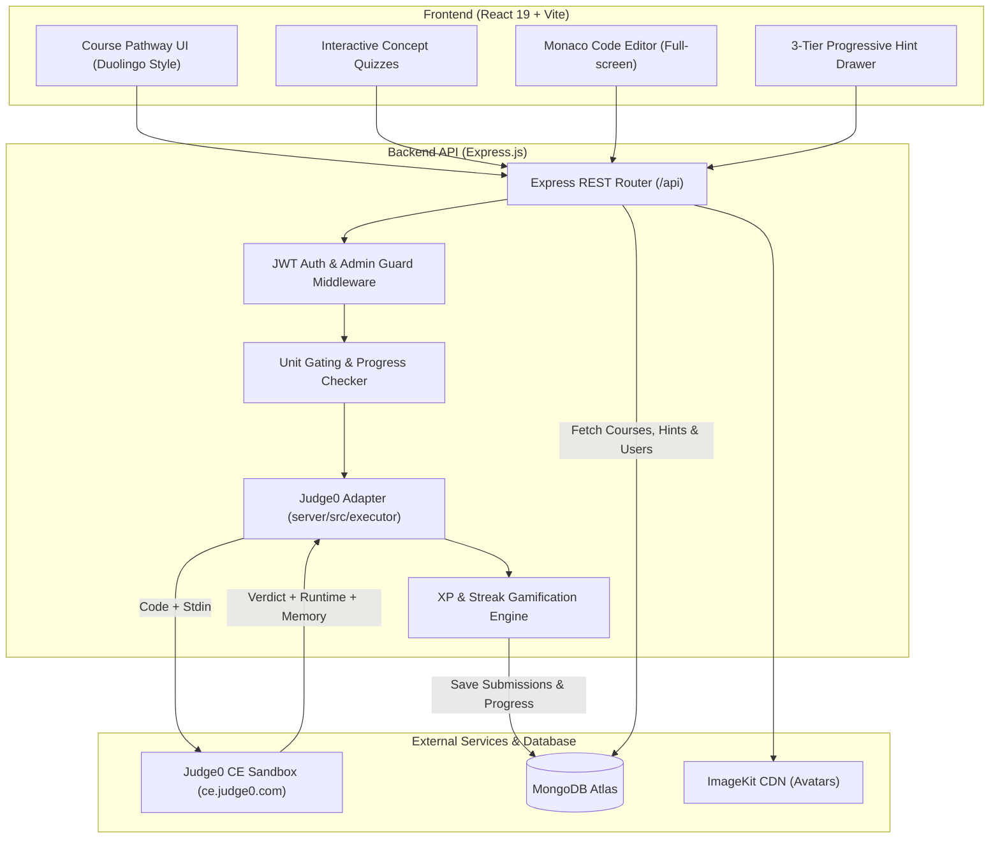

# CodeByte 🚀

<div align="center">


### 🔗 **Live Demo**: [https://codebyte-by-yug.vercel.app/](https://codebyte-by-yug.vercel.app/)

**CodeByte** is an interactive, gamified full-stack coding education platform offering structured, progressive pathways for mastering **C++**, **Java**, and **Python**.

Designed with a distraction-free, Duolingo-style course progression, CodeByte pairs interactive concept quizzes with real, sandboxed coding challenges in a full-screen **Monaco Editor** powered by an **online judge engine**.

</div>

---

## 📸 Overview & Architecture



---

## ✨ Key Features

### 📚 Gamified Circular Learning Pathways
- Progressive curriculum organized into units and lessons across **C++**, **Java**, and **Python**.
- Concept quizzes test mental models, control flow, syntax rules, and algorithmic reasoning.
- Visual pathway node indicators show locked, active, and completed states.

### ⚡ Integrated Online Judge & Monaco Editor
- Full-screen **Monaco Editor** (VS Code engine in browser) with syntax highlighting, line numbers, and dark mode.
- Instant sandboxed code execution powered by a **Judge0 CE adapter** with zero API cost.
- Real-time test case runner showing execution status, runtime in milliseconds, memory consumption, and standard output/stderr diffs.

### 🔒 Track Language Locking
- Coding challenges are pinned to the track's language (e.g. C++ challenges only run in C++, Java in Java, Python in Python).
- Prevents language mismatches on both the client (locked Monaco language indicator) and server (`400 Bad Request` validation).

### 🚧 Unit Progression Gating
- Subsequent units remain locked until the current unit's quiz lessons **and** its terminal coding challenge are solved with an Accepted (`AC`) verdict.
- Solving a challenge for the first time awards **+50 XP**, increments daily streaks, and triggers an interactive celebration modal.

### 💡 3-Tier Progressive Hint Ladder
- Sequential hint system designed for pedagogy without spoiling answers:
  1. **Level 1 (Nudge 💡)**: Gentle conceptual reminder of relevant functions or language features.
  2. **Level 2 (Approach 🗺️)**: Structural roadmap explaining input handling and data flow.
  3. **Level 3 (Step-by-Step 🔍)**: Pseudocode logic and algorithm breakdown (code answers never exposed).

### 🔥 Streaks, Leaderboards & Avatars
- Daily streak tracker encourages consistent coding habits.
- Real-time global leaderboards ranking learners by accumulated XP.
- Profile customization with multi-avatar generators powered by ImageKit.

---

## 🎯 Curriculum & Coding Challenge Matrix

| Course Track | Unit | Quiz Concept Topic | End-of-Unit Coding Challenge | Locked Language |
| :--- | :--- | :--- | :--- | :--- |
| **C++** | Unit 1 | Basics & Control Flow | `cpp-basics-sum-and-average` | C++ (`cpp`) |
| **C++** | Unit 2 | Pointers & References | `cpp-pointer-swap` | C++ (`cpp`) |
| **C++** | Unit 3 | Object-Oriented C++ | `cpp-oop-rectangle-area` | C++ (`cpp`) |
| **C++** | Unit 4 | STL & Vectors | `cpp-stl-vector-sort` | C++ (`cpp`) |
| **C++** | Unit 5 | Templates & Advanced | `cpp-generic-find-max` | C++ (`cpp`) |
| **Java** | Unit 1 | Fundamentals & Loops | `java-fundamentals-multiplication-table` | Java (`java`) |
| **Java** | Unit 2 | Object-Oriented Java | `java-oop-bank-account` | Java (`java`) |
| **Java** | Unit 3 | Collections Framework | `java-collections-frequency-count` | Java (`java`) |
| **Java** | Unit 4 | Exceptions & File I/O | `java-exceptions-safe-division` | Java (`java`) |
| **Java** | Unit 5 | Streams & Lambdas | `java-streams-filter-even-sum` | Java (`java`) |
| **Python** | Unit 1 | Basics & Conditionals | `python-basics-grade-calculator` | Python (`python`) |
| **Python** | Unit 2 | Data Structures & Slicing | `python-ds-list-comprehension-squares` | Python (`python`) |
| **Python** | Unit 3 | OOP & Methods | `python-oop-car-speed` | Python (`python`) |
| **Python** | Unit 4 | Exception Handling | `python-exceptions-safe-int-parser` | Python (`python`) |
| **Python** | Unit 5 | Generators & Iterators | `python-advanced-generator-countdown` | Python (`python`) |

---

## 🛠️ Tech Stack

### Frontend
- **Framework**: React 19 (Vite bundler)
- **Editor**: `@monaco-editor/react`
- **Styling**: Tailwind CSS & Styled Components
- **Icons & Motion**: Lucide React, React Icons, and Motion
- **Routing**: React Router DOM v7
- **Markdown & Audio**: `react-markdown`, `remark-gfm`, and `use-sound`

### Backend & Infrastructure
- **Runtime**: Node.js (v18+) & Express.js (ES Modules)
- **Database**: MongoDB Atlas with Mongoose ODM
- **Execution Engine**: Judge0 CE API adapter with pluggable runner interface (`server/src/executor/`)
- **Authentication**: JWT access & refresh tokens with bcryptjs hashing
- **Media Storage**: ImageKit CDN

---

## 📁 Project Structure

```text
CodeByte/
├── client/                      # Frontend Single Page Application
│   ├── src/
│   │   ├── components/          # Reusable UI widgets, Navbar, Modals
│   │   ├── pages/
│   │   │   ├── Learn/           # Duolingo-style course progression map
│   │   │   ├── Quiz/            # Interactive quiz engine
│   │   │   ├── Judge/           # Monaco editor, ProblemPage, HintPanel
│   │   │   ├── Leaderboard/     # Global XP ranking table
│   │   │   └── Profile/         # User statistics, streak calendar
│   │   └── utils/               # Axios client & API endpoints
│   └── vite.config.js           # Vite frontend configuration
│
├── server/                      # Express Backend REST API
│   └── src/
│       ├── controllers/         # Auth, Quiz, Problem, Submission, Hints
│       ├── models/              # User, Quiz, Problem, Submission, Hint
│       ├── routes/              # Express API route endpoints
│       ├── middlewares/         # JWT protection & Admin verification
│       ├── executor/            # Pluggable Judge0 CE code runner adapter
│       ├── data/                # Courses JSON & MongoDB seed scripts
│       └── server.js            # Express app entry & Vite integration
│
├── docs/                        # Architectural & API Specifications
│   ├── api-docs.md              # REST API endpoint reference
│   └── db-schema.md             # Mongoose collection schemas
│
├── .env.example                 # Sanitized environment template
├── package.json                 # Unified monorepo scripts & dependencies
└── README.md                    # Project documentation
```

---

## 🚀 Getting Started

Follow these steps to run CodeByte locally on your machine.

### Prerequisites
- **Node.js** (v18 or higher)
- **npm** (v9 or higher)
- **MongoDB** (Local instance or MongoDB Atlas URI)

### 1. Clone the Repository
```bash
git clone https://github.com/YugAgarwal005/CodeByte.git
cd CodeByte
```

### 2. Install Dependencies
Dependencies for both client and server are installed via the root `package.json`:
```bash
npm install
```

### 3. Configure Environment Variables
Create a `.env` file in the project root:
```bash
cp .env.example .env
```
Populate the values in `.env`:
```env
PORT=3000
MONGO_URL=your_mongodb_connection_string

# Authentication Secrets
JWT_SECRET=your_jwt_secret_key_here
JWT_REFRESH_SECRET=your_jwt_refresh_secret_key_here

# Google OAuth (Optional)
VITE_GOOGLE_CLIENT_ID=your_google_client_id

# ImageKit Configuration (Optional - for custom avatar uploads)
VITE_IMAGEKIT_URL_ENDPOINT=https://ik.imagekit.io/your_endpoint
IMAGEKIT_PUBLIC_KEY=your_imagekit_public_key
IMAGEKIT_PRIVATE_KEY=your_imagekit_private_key

# Online Judge Engine (Judge0 CE public instance is free and requires no key)
EXECUTOR_ADAPTER=judge0
JUDGE0_BASE_URL=https://ce.judge0.com
JUDGE0_API_KEY=
```

### 4. Seed the Database
Seed the 15 track-aligned problems, 3-tier progressive hints, and wire them to course units:
```bash
npm run seed:all
```

### 5. Launch the Development Server
```bash
npm run dev
```
Open **[http://localhost:3000](http://localhost:3000)** in your browser.

---

## 📜 Available Scripts

| Script | Command | Purpose |
| :--- | :--- | :--- |
| `npm run dev` | `node server/src/server.js` | Starts server with Vite development middleware |
| `npm run build` | `vite build --config client/vite.config.js` | Compiles production assets into `client/dist` |
| `npm run start` | `NODE_ENV=production node server/src/server.js` | Runs production server serving compiled static assets |
| `npm run seed:all` | Seed problems + hints + course wiring | Complete database bootstrap in one command |
| `npm run seed:problems` | `node server/src/data/seed-problems.js` | Seeds the 15 concept-aligned coding challenges |
| `npm run seed:hints` | `node server/src/data/seed-hints.js` | Seeds 3-tier progressive hints for all challenges |
| `npm run seed:wire` | `node server/src/data/wire-exercises.js` | Wires coding challenges into course unit progression |

---

## 📖 Detailed Documentation

- **[REST API Documentation](./docs/api-docs.md)**: Complete request and response specifications for auth, courses, quiz grading, judge execution, and hints.
- **[Database Schema Documentation](./docs/db-schema.md)**: Mongoose schemas, relationships, indexing, and field validations.

---

## 📄 License
This project is licensed under the **MIT License**.
